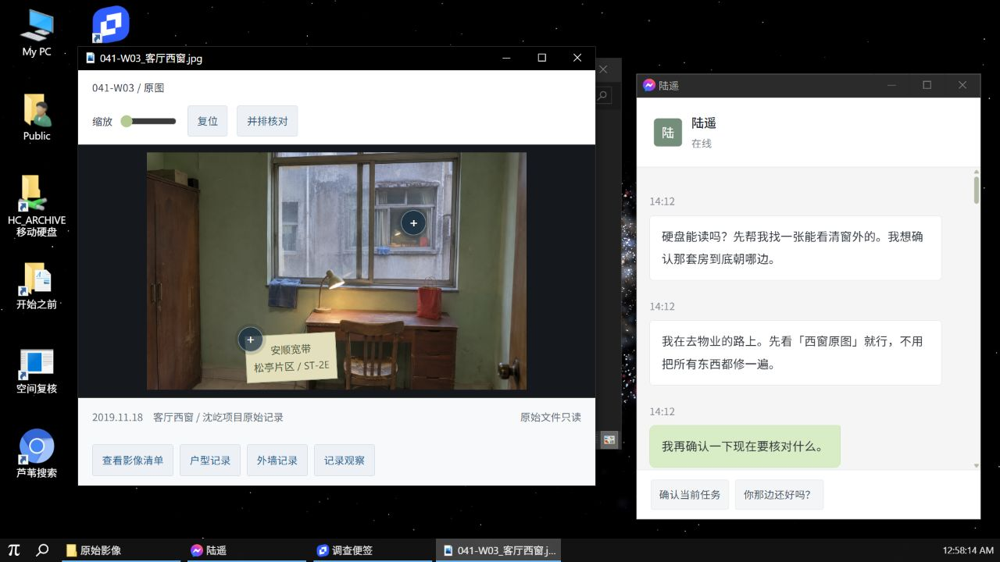

# 没有窗外 · found-game

一个发生在浏览器虚拟电脑里的中文微恐调查解谜游戏。

朋友寄来一块旧硬盘，请你找一张能看清窗外的照片。你在文件夹、聊天记录、旧网页和测绘档案之间寻找线索，逐渐发现，这些房间似乎没有一个稳定的外部。

桌面环境直接采用 [Dustin Brett 的 daedalOS](https://github.com/DustinBrett/daedalOS)，游戏以独立应用接入它的窗口与文件系统。当前版本为 **v0.2.0 玩法原型**，尚未公开部署。



## 可以怎么玩

- 在原生文件管理器中打开移动硬盘，阅读资料、查看照片和回放片段。
- 从照片、邮件与聊天中提取关键词，在虚构的「芦苇搜索」中查找旧网页。
- 用调查便签核对证据、整理时间线、写下猜测；卡住时可以请求渐进提示。
- 使用空间复核工具验证关联，根据现场反馈决定下一步操作。
- 通过12个调查节点推进故事，进入不同结局。

恐怖感主要来自文字中的异常、重复物件和逐渐失去可信度的空间关系，没有突脸惊吓。网页、地点、公司与人物均为虚构。游戏不会调用真实摄像头、麦克风、地理位置或自动读取玩家的本机文件。

## 从源码启动

建议使用 **Node.js 22 LTS** 及其附带的 npm，本次验证版本为 Node.js 22.23.1。仓库保留了 daedalOS 的第三方应用资源，首次下载和安装可能较慢。

```bash
git clone https://github.com/Z41sArrebol/found-game.git
cd found-game
npm ci
npm --prefix desktop ci --ignore-scripts
npm run build:desktop
npm start
```

打开 [http://127.0.0.1:4178](http://127.0.0.1:4178)。Windows 上完成首次构建后，也可以双击根目录的 `启动游戏.cmd`。构建产物不提交到 Git，首次克隆后必须先构建。

建议使用独立的电脑浏览器窗口。先进入 HC_ARCHIVE 移动硬盘的「原始影像」文件夹，双击客厅西窗照片。窗口可以拖动、缩放、最大化和最小化，任务栏可切换应用。

### 开发模式

完成上面的依赖安装后运行

```bash
npm run dev:desktop
```

开发地址为 [http://127.0.0.1:4179](http://127.0.0.1:4179)。启动前会自动同步游戏内容并生成虚拟文件系统索引。

### 常用命令

| 命令 | 用途 |
| --- | --- |
| `npm test` | 验证调查节点、证据要求、搜索、存档及结局逻辑 |
| `npm run sync:game` | 把剧情、逻辑与素材同步到桌面应用目录 |
| `npm run dev:desktop` | 同步内容、生成索引并启动开发服务 |
| `npm run build:desktop` | 同步内容并构建静态桌面到 `desktop/out/` |
| `npm start` | 启动已经构建的静态版本，默认端口4178 |

修改桌面下的其他文件或快捷方式后，可单独运行 `npm --prefix desktop run build:prebuild` 更新索引。

## 后续修改从哪里入手

| 路径 | 内容 |
| --- | --- |
| `dist/content.js` | 当前剧情文本、调查问题、资料和结局 |
| `dist/engine.js` | 证据条件、节点推进、搜索与存档逻辑 |
| `dist/app.js` | 调查应用的交互逻辑，同时保留早期桌面原型 |
| `dist/sim.css` | 面板拟真皮肤（微信/OneNote/Edge/照片查看器/测量软件），仅面板模式生效 |
| `dist/assets/` | 游戏影像素材的编辑源目录 |
| `scripts/integrate-daedalos.mjs` | 内容同步、窗口内容样式、快捷方式与进程注册 |
| `desktop/components/apps/CaseApp/` | 游戏应用与 daedalOS 原生窗口的通信桥接 |
| `desktop/hooks/useCaseBoot.ts` | 首次打开的应用和初始窗口位置 |
| `desktop/hooks/useCaseFiles.ts` | 随剧情把现场附件写入虚拟硬盘 |
| `desktop/public/case/` | 同步后的应用内容，会被同步脚本覆盖 |
| `tests/engine.test.js` | 剧情引擎测试 |
| `docs/story-design-v0.1.md` | 最初的完整剧情设计稿，含剧透，与当前流程有差异 |

当前仍保留早期原型到原生桌面的同步层。调整剧情和应用交互时，优先改 `dist/` 中的源文件或同步脚本，再运行同步命令；直接修改 `desktop/public/case/` 会在下次同步时被覆盖。

## 存档与部署

调查进度存放在当前站点的 localStorage，虚拟文件和桌面窗口状态存放在 IndexedDB。不同浏览器、不同域名和不同端口的存档互不通用，清除站点数据会移除存档。

构建完成后，可以将 `desktop/out/` 部署到支持静态网站的服务器。根目录的本地服务仅监听 `127.0.0.1`。自行部署时，建议参照本地服务配置以下响应头，并确保 `.wasm` 以 `application/wasm` 返回。

```text
Cross-Origin-Opener-Policy: same-origin
Cross-Origin-Embedder-Policy: credentialless
```

## 当前完成度

剧情引擎的7项测试、生产构建和类型检查已通过。原生桌面中的文件导航、窗口操作、照片观察、搜索与跨窗口同步做过实际浏览器验证，见 [桌面验收记录](DESKTOP-VALIDATION.md)。

尚未在新桌面中逐步重玩完整剧情，也没有经过陌生玩家的难度、恐怖感和实际游玩时长测试。影像回放采用生成静帧与分段文字，原版自带的第三方模拟器和附加应用未逐项验证。

## 来源与相关文档

- 桌面底座为 daedalOS，遵循原项目的 [MIT 许可](desktop/LICENSE)；上游版本及本地改动见 [DAEDALOS.md](DAEDALOS.md)。
- Burn-My-Windows 动画资源保留其 [GPL-3.0 许可](desktop/vendor/burn-my-windows/LICENSE)，其他上游资源见 [daedalOS CREDITS](desktop/public/CREDITS.md)。
- 游戏图片由生成模型制作，素材用途见 [ASSETS.md](ASSETS.md)，完整提示词见 [image-prompts.json](image-prompts.json)。
- 初版流程取舍见 [PLAYTEST.md](PLAYTEST.md)。涉及谜底的设计与逻辑文件建议试玩后再阅读。
