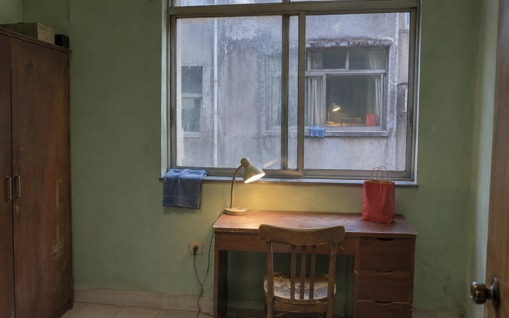
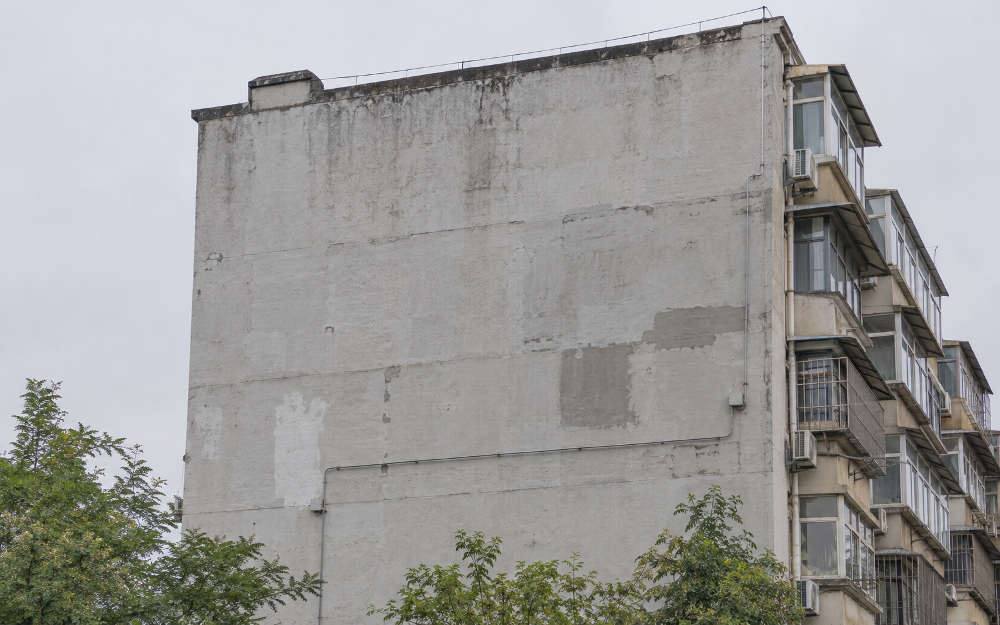
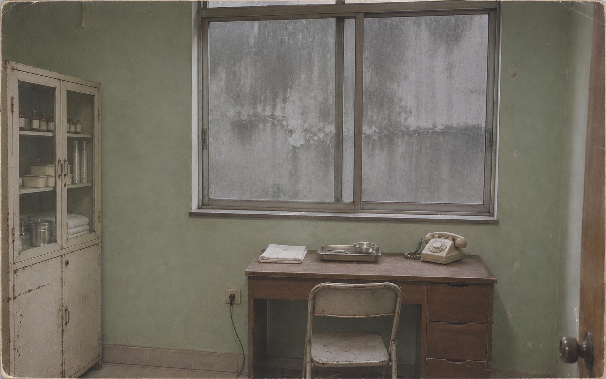
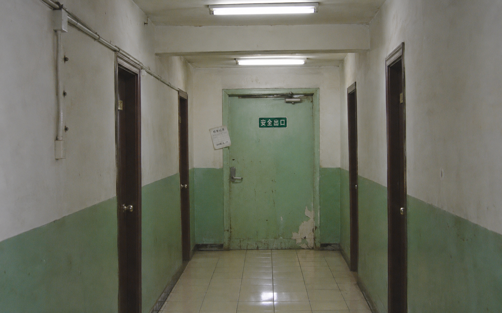
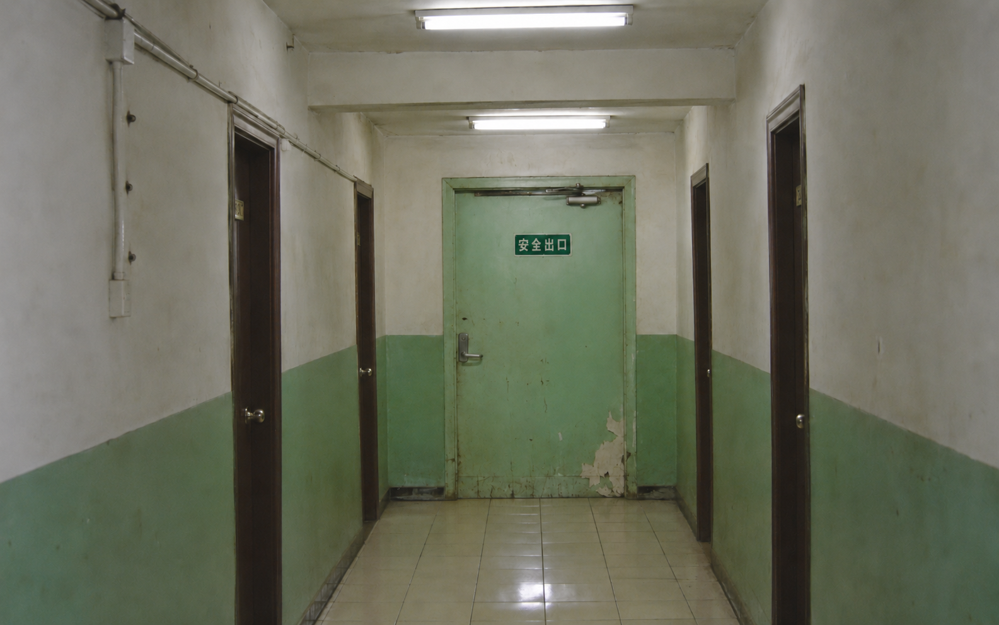
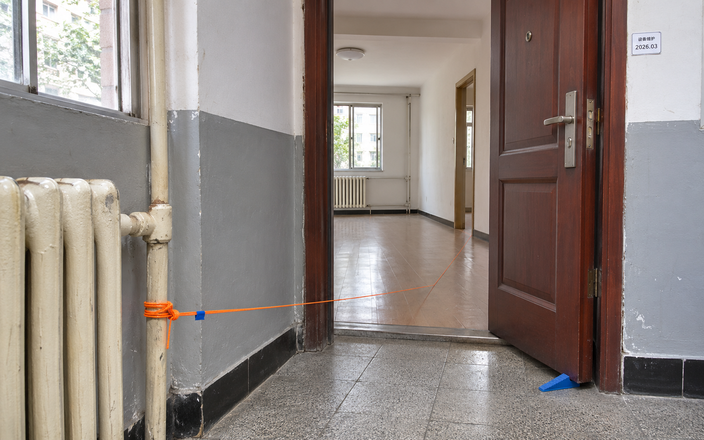
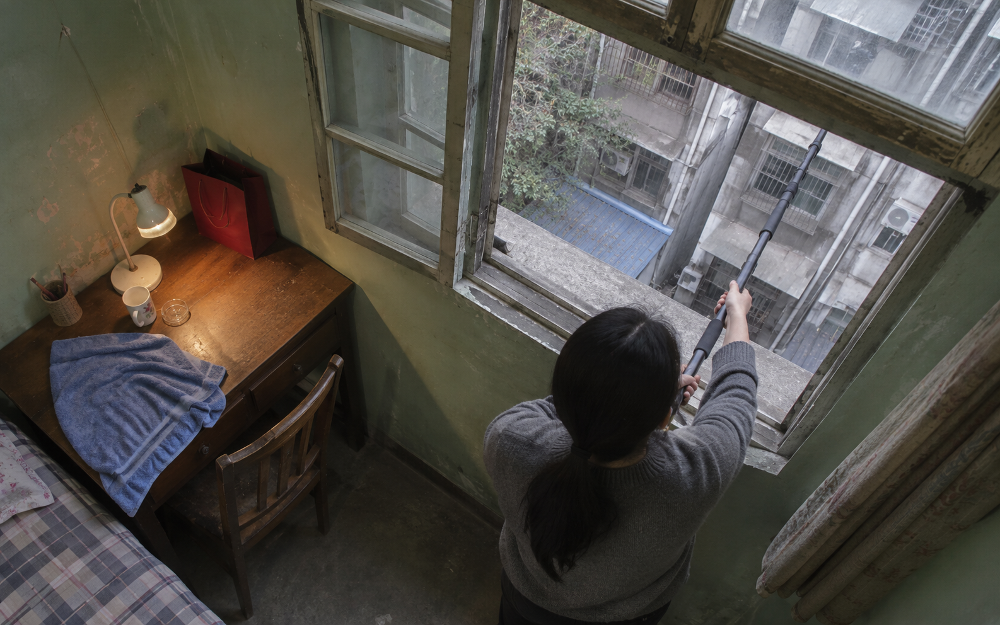
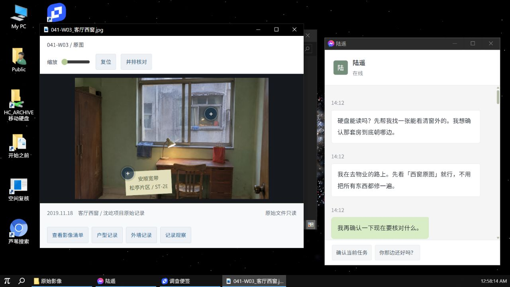

# 修改方案 v0.3–v0.5（2026-11-12）

依据：对 v0.2.0 的可玩性 / UI / 剧情 / 创意评审。本文含剧透。

## 0. 不动的原则

改动都在这几条之内进行，任何方案与之冲突以这里为准：

- **证据门**是核心资产：推进必须由玩家拿出的证据支撑，不靠排除法。
- **原始记录稳定**：已保存的照片、录像、文档永不变化；变化只发生在现场回传、关联预览和外部世界（论坛）。
- **不触碰现实信息**：不读摄像头、麦克风、地理位置、本机文件、真实用户名。所有“它在看你”的效果只用浏览器内部状态。
- **无突脸**：最强刺激是≤100ms 的一帧异常和文字。
- **错误可恢复**：不设真实倒计时，不设永久失败。

---

## 阶段 A　剧情一致性（v0.3 前置，约 1 天）

先修设定冲突，成本最低、后面所有改动都依赖它。

### A1 入口帖时间线统一（`desktop/public/forum.html`）

| 位置 | 现状 | 改为 |
|---|---|---|
| 标题 / `<title>` | 2019 年的照片最近"不对劲" | 2019 年的照片，我越看越不对 |
| #1 正文第二段 | 我去看了房：广告写朝东，屋里却只有西边有光 | 广告写的朝东，可照片里的光是从西边来的。我约了物业，明天下午开门看房 |
| #1 正文第三段 | 不对劲的是有几张照片和现场对不上 | 不对劲的是有几张照片和那栋楼的图纸对不上 |
| #6 | 2020 年那片确实出过一次测绘事故 | 19 年底那片确实出过一次测绘事故 |

理由：照片“最近变了”违反“原始记录稳定”；陆遥在游戏里是第一次去现场；事故日期以修订记录 2019-11-20 为准。

### A2 玩家身份衔接

问题：读帖时玩家是陌生网友，进桌面后陆遥像老朋友一样说话。

- forum 新增 #8（陆遥，2026-11-11 13:50）：
  > 更新：我拜托了一位做影像修复的老朋友远程帮我看硬盘，我下午去现场。进展更新在这楼。
- 附件按钮文案“打开镜像”不变；跳转后的首条聊天改为：
  > 帖子你看到了吧，镜像就是那份。先帮我找一张能看清窗外的。

这样“读帖”就是许澄接活前看到朋友发的帖，POV 闭合。

### A3 陈苇线收束

现状：入口帖把陈苇定为陆遥的朋友，好结局却只有“下落仍需调查”。设计稿要求“陈苇遭遇了什么必须可验证”。

**事实补全（作者侧）**：2019-11-20 闭合时陈苇在内部；沈屹 11-21 解除一处关联、保留开放方向，就是为她留的回路。器材包里那截污损断绳是她当年的绳。

**玩家可见的证据（新增 / 改写）**：

1. `rope`（器材卡）补一句：断绳的绳扣上缠着一圈褪色的蓝色发圈。并新增配图 `assets/rope.png`（由 GPT Image 生成后同步至 `dist/assets/rope.png` 与 `desktop/public/case/assets/rope.png`，提示词见附录）。
2. 新增现场回传 `trace`（stage 9 后写入现场回传目录）：陆遥在走廊墙上看到铅笔字“站起来以后，窗又到前面去了”，与陈苇随手记 11-10 一字不差；地上有一只红色外卖袋。配现场照片 `assets/trace.png`（由 GPT Image 生成并同步，提示词见附录）。
3. `log` 11-21 条改为：解除一处关联，**保留开放方向，不要替她关上**。原始记录封存。

**结局分支（`endings`）**：救援最后一步后新增一个可选动作“把旧绳系在五米双结上再走”。

- 前提：玩家读过 `trace`、`log`、`rope`（engine 用 `requires` 判定，没读过则该选项不出现）。
- 选了 → `safe-marked` 结局，在 safe 的台词后追加：
  > 覆盖图仍有一个缺口。
  > 凌晨三点，物业发来一条消息：门楔动了一下。屋里没有人。
- 没选 → 原 `safe`。

这让“保留缺口”从规则变成希望，也给了二周目理由，并且仍不解释陈苇是否生还。

### A4 沈屹线

- forum 第 2 页（`pager` 的“2”改为可点，渲染第 2 页）末楼，匿名账号 `hc_tmp_041`，注册 2019-11-22，帖子 1：
  > 别补齐。
- 不再出现，不进聊天。符合“聊天中的实时人物始终是陆遥”。

### A5 陆遥台词去讲解（`chatReplies`）

规则：**处境越危险，话越短、越具体；推理永远交给玩家。**

- 删除 `why` 字段的“教学式”文本（如“一次变化可能是巧合。暂停再恢复，重复出现才是证据”）。问“为什么”时改为给一条**现场感官细节**，不给推理：
  - stage 7：「告示边上有块胶带印子。刚才没有。」
  - stage 9：「日志你看到哪了？我这边灯一直在闪。」
- stage ≥ 6 的 `v` 全部压到 ≤ 15 字；stage ≥ 9 允许出现不完整句和错别字（如“绳在”“你快点”）。

**验收**：通读 `content.js` 中 stage ≥ 6 的陆遥台词，没有一句同时包含“因为/所以/说明/证明”。

---

## 阶段 B　谜题机制重做（v0.3 核心，约 4–5 天）

### B1 出示证据机制（替代三选一）

**问题**：9 道三选一里有 8 道正确答案在 B 位，错误项一眼可排除。

**机制**：

1. **可引用单元**：同步脚本（或 reader 渲染时）把每份文档的 `<p>/<li>/<td>/<blockquote>` 自动包成 `<span data-cite="{docId}:{n}">`。关键句另加显式 id（`data-cite="plan:west-wall"`），**外观与普通句完全一致**，不泄题。
2. **图像区域**：照片热点改为可引用区域（`room:far-lamp`、`room:far-towel`、`room:label`…），放大到 ≥2× 时才响应点击。
3. **证物栏**：调查便签新增“证物”区。reader 里选中句子或点击区域 → 浮出“记入便签”。上限 8 条，可删。
4. **出示**：陆遥提问时，聊天输入区出现“出示”按钮，打开证物栏，选 1–2 条发送。

**引擎**（`dist/engine.js`）：

```js
// puzzle 新字段
cite: {
  need: [['plan:west-wall'], ['exterior:photo','exterior:caption']], // 每组至少出示一条
  wrong: ['这条说的不是那面墙。', '…'],   // 角色内回应，轮换
}
export function resolveCite(s, ids) { /* missing() 门 → 每组命中 → 推进 */ }
```

- 出示错误不惩罚，第 2 次错误后接现有 hint 体系。
- `history` 记录出示内容，便签“已核对”区显示玩家自己出示的句子（而不是 ABC 选项）。

**测试**（`tests/engine.test.js`）新增：分组命中、缺证据拒绝、错误轮换、存档兼容（`version` 升到 2，`hydrate` 把 v1 存档的 stage 原样迁移）。

### B2 12 个节点的新形式

| # | 节点 | 现形式 | 新形式 | 要点 |
|---|---|---|---|---|
| 0 | 影像复核 | 三选一 | **标注** | 在远窗里点出 ≥3 处与近处相同的物件（台灯/毛巾/外卖袋/桌角烫痕任选 3），点错不扣分 |
| 1 | 寻找房屋 | 输入 | 保留输入 | 已完成 |
| 2 | 核对外墙 | 三选一 | **出示 2 条** | 户型图西墙 + 外墙照片 |
| 3 | 租客最后几天 | 排序 3 张抽象卡 | **排序 5 张原文卡** | 卡片直接是随手记/邮件原句；混入 1 张无关的（尾款记录）需丢弃 |
| 4 | 杯子测试 | 三选一 | **量帧 + 输入** | 见 B6，回答延迟秒数 |
| 5 | 相同的结构 | 三选一 + 空间工具 | **只保留空间工具** | 从两地原始记录求交集选 3 个特征，选中即推进，删掉问题 |
| 6 | 现场关联 | 三选一 | **选择注册哪张** | 陆遥描述门（绿漆、推杠）→ 在榆宁/永新两张旧照里选对应的一张注册 |
| 7 | 验证变化 | 三选一 | **操作 + 出示** | 暂停→恢复后，出示两条现场回报（告示消失 / 告示回来） |
| 8 | 查找出口 | 三选一 | **聊天对质** | 陆遥问“我进不进？”，出示 2008 检查纸 + 当日入口记录的门楔/标签 |
| 9 | 事故记录 | 三选一 | **输入** | 陆遥问“他们哪天出的事？”→ 11月20日（容错：11.20 / 11-20 / 20号） |
| 10 | 撤回方法 | 三选一 | **密码门 + 拼表** | R-03 加密，密码是陈苇在租房站的 ID（转租帖评论区可见）；解锁后把 3 段原始记录拖进 A/B/C 列，表成立即推进 |
| 11 | 沿绳返回 | 三步选择 | **触觉找绳** | 见 B7 |

全游戏不再有三选一判断题。形式分布：输入（1、4、9、10 密码）、出示（2、4 第二问、7、8）、直接操作（0、5、6、11）、排序/拼表（3、10）。

#### 现有资产复核与节点引用对照


*`room.png`：节点 0 需在远窗（右上窗内）标注 ≥3 处与近处相同的物件（台灯、蓝色毛巾、红色外卖袋、桌面/椅背）；节点 1 核对左下角安顺宽带维修贴纸。*


*`exterior.png`：节点 2 与户型图西墙粗单线对照出示，证明顶层西侧为无窗连续砖墙。*


*`clinic.png`（YN-94-06）：节点 5 对照三处结构特征；节点 6 作为干扰项与永新宾馆走廊区分。*


*`corridor.png`（YX-08-12）：节点 6 凭“绿漆、推杠/安全出口”选此图注册；节点 7 与 `corridor-paused.png` 对照左侧 2008 检查纸消失/复现；节点 8 对质假出口。*


*`corridor-paused.png`：左侧墙面无 2008 检查纸，用于节点 7 暂停对照与 D4 恢复关联瞬间的 ≤100ms 闪帧。*


*`entrance.png`：暖气立管锚点、橙色测绳、起点蓝胶布、入户门下蓝色橡胶门楔、门框旁 2026.03 维护标签。节点 8 用于证伪绿色安全门，节点 11 用于确认真实出口。*


*`ceiling.png`：摄影杆伸出窗外却从室内天花板俯拍陈苇后脑，节点 9 结合日志确认 11 月 20 日环绕闭合事故。*

### B3 资料去结论化（`dist/content.js`）

| 文档 | 删除 | 保留 / 改为 |
|---|---|---|
| `plan` | “西墙是承重外墙，没有开窗；采光从南侧阳台来” | 正文只写“原始平面图存一下，回头装修对照”。平面图加图例“细双线＝窗”，西墙画粗单线 |
| `exterior` | “西立面顶层为连续砖墙，无门窗开口” | 只留照片、定位标记、“本次仅修补墙面” |
| `archives` | 三条特征清单 + 沈屹批注 | 改为两份测量员原始记录，各 4–5 条，交集 3 条（窗台缺口/三孔/回折线槽），非交集项如“铸铁暖气片”“北向门” |
| `experiment` | A/B/C 汇总表与两句比较结论 | 改为 3 段现场记录原文（含时间、绳状态、撤回情况），结尾只留手写批注“它是不是也在算我们在哪里” |
| `rope` | “两段都是橙色。不要只按颜色选。” | 移入 hint 第 1 级 |
| `ad` 评论区 | — | 新增陈苇 ID（如 `qingwei_1107`），供节点 10 密码使用 |

`manual` 不改：说明书本来就该写规则。

### B4 坏结局变成诱惑

现在补齐覆盖只是一个有警告的按钮，没有人会点。

1. stage 10 起陆遥会主动发一次（只一次）：
   > 你把缺的那个方向补上，是不是就能看见我在哪？我不想再摸着走了。
2. 空间复核“补齐覆盖”按钮悬停提示：`可计算完整返回路线 · 预计 00:42`。
3. 确认弹窗删掉“原项目明确标注不允许自动补齐”这句（玩家已在说明书里读过，弹窗不再替玩家记）。
4. 保留 checkpoint 回退。坏结局回执上加一行“返回危险选择之前”。

### B5 软压力（不计时）

- stage ≥ 6：玩家 90 秒无有效操作（打开文档 / 出示 / 输入）时，陆遥从 `idle[stage]` 池里发一条，最多 3 级，越来越短：
  `我还在。` → `你那边没事吧` → `……`
- 输入区状态行“陆遥正在输入 ●●●”出现 4 秒后消失，**不发消息**，每阶段最多一次。
- 不影响任何判定，玩家随时可以无视。

### B6 杯子测试改成量帧

- `videoView` 改为双画面（近窗 / 远窗）+ 共享时间轴，可逐帧拖动（4 段 × 若干静帧即可，不需要真视频）。
- 远窗动作滞后 2 秒；伸出的手从桌下出现（基于 `room.png` 用内置 `image_gen` edit 模式生成真实静帧 `cup-hand.png`，替换原 CSS 色块，提示词见附录）。
- 陆遥问：“远处那个慢了多久？”→ 输入秒数（容错 2 / 2秒 / 两秒 / 约2秒）。
- 第二问用出示：引用“手出现的那一帧”区域（`cup:hand-frame`）。

### B7 触觉找绳（救援）

- 全屏变暗，只留聊天窗口的一条细边。鼠标按住即“握绳”。
- 场景里有一条看不见的折线路径。光标离路径越远，低频声越弱、光标轻微抖动；松手或偏离 > 阈值 → “手里空了”，退回上一个绳结，不失败。
- 每经过 1 米触发一次轻“咔”（单结），5 米双响（双结），陆遥报数。
- 双结之后路径分叉：一支通向“看得见的门”（视觉上更亮），一支继续沿绳。走向亮处会被陆遥拒绝：“这不是绳的方向。”
- 到蓝色胶布后**必须等待**：物业消息“门楔动了，我看见了”到达后才能松手。
- 无障碍：提供方向键模式（声音提示同上）和“简化模式”（退回现有三步选择）。设置入口放在便签右上角。

---

## 阶段 C　UI（v0.4，约 2 天）

### C1 壁纸

- `desktop/utils/constants.ts` 的 `DEFAULT_WALLPAPER` 从 `GALAXY` 改为静态图片（需核实 daedalOS 图片壁纸的加载路径与 session 缓存，旧存档的 IndexedDB 里可能存了 GALAXY，需要一次迁移）。
- 图片：陆遥发来的旅游照（设计稿里本就有这一项），用内置 `image_gen` 生成一张普通、略过曝的手机照片 `wallpaper.png`（提示词见附录）。
- Stage ≥ 9 时静默换成同一张照片的 edit 变体 `wallpaper-stage9.png`，背景楼上多了一扇亮着台灯的窗（提示词见附录）。不提示，留给细心玩家。

### C2 照片查看器


*现状对照：1) 背景为 `GALAXY` 星空（C1 改为旅游照 `wallpaper.png`）；2) 照片上有两个“+”热点圆钮（C2 删除，改为 ≥2× 缩放时响应区域点击）；3) 底部有“户型记录 / 外墙记录”直达按钮（C2 删除）；4) 右侧聊天窗使用 Messenger 图标（C4 改为自绘绿色气泡）。*

- 删除两个 “+” 热点图标。可引用区域只在放大 ≥2× 时让光标变成 `zoom-in`。
- 删除底部“户型记录 / 外墙记录”按钮（这是替玩家走下一步）。“查看影像清单”保留（真实看图软件会有“同目录”入口）；“记录观察”改为通用的“记入便签”。

### C3 时间

- 聊天时间戳改用玩家本机时间（`storyTime()` 改为 `new Date()` 的 zh-CN 时分），与任务栏一致。
- 陆遥开场不提具体时刻。坏结局的“新视点在你椅背上方”与真实时间同步，压迫感更强。

### C4 统一软件外观

- 聊天窗口的 Messenger 图标换成自绘绿色气泡图标；窗口标题“陆遥”保留。
- 公开发布前把仿微信 / OneNote / Edge 的皮肤改成**虚构品牌**（保留布局，去掉可识别的商标元素与配色签名），规避商标风险。品牌名不要再用“芦苇”系（论坛和搜索已经占了），比如聊天叫“回声”、笔记叫“页边”。

### C5 文案

| 位置 | 现状 | 改为 |
|---|---|---|
| 聊天快捷按钮 | 确认当前任务 | 下一步看哪？ |
| 聊天快捷按钮 | 你那边还好吗？ | 保留 |
| 便签空态 | — | 还没有记下任何东西。 |

### C6 裁剪 daedalOS

- `desktop/public/Program Files`（243M）只保留游戏用到的依赖。预计可删：Quake3、BoxedWine、Virtual x86、EmulatorJs、js-dos、Pyodide、StableDiffusion、ClassiCube、DX-Ball、SpaceCadet、Chess、Tic80、Webamp、Ruffle、kiwiirc、eSheep、DesktopFly、jspaint、MonacoEditor、Vim.js 等。逐项删后跑 `npm run build:desktop`，同时删除 `processDirectory` 中对应注册和开始菜单快捷方式。
- 目标：`public` 总量 < 60M，首屏加载 < 5 秒（本地 4178）。
- 顺手清理 `.runtime/` 下的 `.part` 续传残片（确认未被 Git 跟踪后删除）。

---

## 阶段 D　创意亮点（v0.5，约 3 天）

### D1 活帖子（原路线 R3，扩写）

论坛页监听 `storage` 事件，按 `stage` 渲染新楼层：

| 触发 | 新楼层 |
|---|---|
| stage 2 | 栗子壳：「户型图我也翻到了，西边那面墙……楼主你确定照片没 P 过？」 |
| stage 6 | 陆遥：「我进来了。信号不太好。」 |
| stage 7 | 物业账号：「该户现场无人。门开着。」 |
| stage 8 | 栗子壳：「说明书里那个自动补齐我试了，确实能算出完整路线，挺准的」 |
| stage 9 | 栗子壳最后在线时间停在上一楼，此后不再变化 |
| safe | 陆遥：「出来了。谢谢。」 |
| safe-marked | 同上，再加物业：「凌晨门楔动了一下，监控里没人。」 |
| bad | 一个新用户：「楼主，你的电脑现在是不是也开着这个页面」 |

栗子壳这条线不说教，却比任何警告都更能说明补齐的后果，同时加强 B4 的诱惑。

### D2 活动终端 = 浏览器标签页

- 用 `BroadcastChannel('no-outside')` 统计同源打开的游戏页面数（桌面 + 论坛 + 任何复制的标签）。
- 空间复核右侧显示 `活动终端 N`。玩家同时开着论坛和桌面时 N = 2。
- 坏结局文案引用这个数字：「已定位 2 个活动终端。」
- 只用浏览器内部状态，不越过 0 节的边界。

### D3 坏结局的窗口套娃

- 坏结局触发后，桌面弹出一个新窗口，标题“新视点 · 041-R-07”，内容是当前桌面 DOM 的静态克隆（不截屏、不需要任何权限），缩小显示；克隆里也有这个窗口，递归 3 层后变黑。
- 2 秒后接原来的结局文本。

### D4 声音层（原路线 R4）

WebAudio 合成，无音频资产，默认关闭，首次进入时便签里给一个开关：

- 关联激活时：40–60Hz 低频嗡鸣，暂停时淡出。
- 恢复关联瞬间：一帧 `corridor-paused.png`（≤100ms），同时嗡鸣停 200ms。
- 救援阶段：B7 的绳结声和距离声。

---

## 阶段 E　验证

### 自动

- `npm test`：B1 的引擎测试 + 12 节点全路径可达 + 三个结局可达 + v1 存档迁移。
- `scripts/browser-qa.mjs` 补：出示流程、量帧输入、触觉救援的简化模式通关。

### 陌生玩家试玩（至少 3 人，不给任何说明）

按 `PLAYTEST.md` 已列指标记录：首次发现异常用时、第一次搜索输入、卡关位置、提示使用次数、总时长。再加三条：

1. 是否有人点了补齐（B4 是否成立）。
2. 出示错误的次数分布（看哪个节点太难或太模糊）。
3. 结束后问一句“陈苇怎么样了”，看 A3 的痕迹有没有被读到。

---

## 排期

| 版本 | 内容 | 估时 | 依赖 |
|---|---|---|---|
| v0.3 | A 全部 + B1 / B2 / B3 / B4 / B5 | 5–6 天 | A 先于 B3（文案要一起改） |
| v0.4 | C 全部 + B6 / B7 | 4 天 | B1 的证物栏先完成（B6 用到出示） |
| v0.5 | D 全部 + E 试玩 | 3–4 天 | D1 依赖 A1 / A2 的论坛结构 |

**最先做**：A1 → A2 → B1（引擎 + 证物栏）。B1 一旦成立，B2 的大部分节点只是填数据。

## 明确不做

- 不加第二个实时聊天人物、不做真假好友关卡。
- 不做真实倒计时与永久死亡。
- 不让游戏内文本出现任何玩家的现实信息（用户名、IP、所在地、本机文件名）。
- 不为陈苇的生死给出确定答案。

---

## 附录：v0.3–v0.5 新增影像资产生成任务（供 GPT / Codex 执行）

执行本方案时，请使用内置 `image_gen` 工具生成以下 6 张影像资产，并执行以下落盘步骤：
1. 将生成的 PNG 保存至 `dist/assets/<name>.png`，并同步复制到 `desktop/public/case/assets/<name>.png`（壁纸同步到 `desktop/public/System/Wallpapers/` 或对应静态目录）。
2. 将新增条目的 `{ key, prompt, mode }` 追加写入根目录 `image-prompts.json`。
3. 更新 `ASSETS.md` 的资产用途表，并重新计算 SHA-256 与字节数写入 `dist/assets/manifest.json` 及 `desktop/public/case/assets/manifest.json`。

### 生成清单

| 文件名 | 对应章节 | 用途说明 | 生成模式 |
|---|---|---|---|
| `trace.png` | A3 陈苇线收束 | Stage 9 后写入现场回传目录 `trace`：走廊墙面上的铅笔手写字与地面上的红色外卖纸袋 | `built-in generate` |
| `rope.png` | A3 陈苇线 / 节点 11 | `rope`（器材卡）配图：展示“带褪色蓝色发圈的 2019 污损断绳”与“带蓝色胶布的新放线绳” | `built-in generate` |
| `cup-hand.png` | B6 杯子测试量帧 | 节点 4 第二问出示“手出现的那一帧”，替换原 CSS 块，展示远窗桌下伸出的手将白杯放上窗台 | `built-in edit`（底图 `dist/assets/room.png`） |
| `wallpaper.png` | C1 壁纸 | 替代 `GALAXY` 星空默认壁纸：陆遥发来的普通、略过曝手机旅游照 | `built-in generate` |
| `wallpaper-stage9.png` | C1 壁纸变体 | Stage ≥ 9 静默替换：同一张旅游照，远处居民楼顶层多出一扇亮着暖黄台灯的窗 | `built-in edit`（底图 `wallpaper.png`） |
| `street.png` | `safe` 结局 | 陆遥撤出后发来的街口照片（构图微歪、边缘有开走的车），用于好结局收束 | `built-in generate` |

### 提示词（与 `image-prompts.json` 格式一致）

```json
[
  {
    "key": "trace",
    "prompt": "Use case: photorealistic-natural. Create ONE landscape 16:10 handheld smartphone documentary evidence photograph taken in a dim, shabby old Chinese apartment corridor, uneven flashlight illumination. On the mottled off-white and faded green lower plaster wall near the corner, faint hasty handwritten Chinese pencil text reads \"站起来以后，窗又到前面去了\" in small ordinary handwriting. On the dusty cream tile floor right below the wall sits a crumpled red paper takeout bag with twisted paper handles (matching the red bag from the apartment desk). An orange thin survey cord passes across the bottom edge of the floor. Mundane, unsettling factual evidence photo, no people, no monsters, no blood, no gore, no cinematic filters, no UI.",
    "mode": "built-in generate"
  },
  {
    "key": "rope",
    "prompt": "Use case: photorealistic-natural. Create ONE landscape 16:10 close-up documentary evidence photograph of a dark grey canvas survey equipment bag open on a concrete floor. Inside and beside the bag are two distinct segments of orange survey cord: on the left, a short, frayed, dirty 2019 broken orange cord segment with a severed end, and wrapped around its metal clip is a faded pale-blue elastic hair tie; on the right, a clean, continuous new orange survey cord spooling out from the bag with a small blue tape marker. Factual overhead handheld photo, neutral indoor lighting, sharp focus on the faded blue hair tie and frayed cord end, no people, no text, no UI.",
    "mode": "built-in generate"
  },
  {
    "key": "cup-hand",
    "prompt": "Edit target: the attached room.png photograph. Keep the exact same camera framing and room geometry. Place a simple white ceramic cup on the near window sill (left-center). In the distant window across the courtyard, show a pale, slightly awkward human-like forearm and hand reaching UPWARD from underneath the distant desk (where a standing person could not possibly fit), placing an identical white ceramic cup onto the distant window sill. The wrist is stiff and unnaturally angled. Slight 2019 digital video compression grain. No monster face, no blood, no gore—just an impossible, quiet anatomical angle in the distant window.",
    "mode": "built-in edit"
  },
  {
    "key": "wallpaper",
    "prompt": "Use case: photorealistic-natural. Create ONE landscape 16:10 casual smartphone travel photograph taken on a bright afternoon in an ordinary Chinese coastal or riverside small town. Slightly overexposed sky, natural smartphone camera dynamic range, a quiet concrete promenade or old stone bridge in the foreground, calm water, and a cluster of aging 6-storey residential apartment buildings in the mid-background against low hills. Unedited everyday snapshot sent by a friend, warm and mundane, no people posing in foreground, no text, no watermarks, no UI. All details in the background apartment windows should be dark or unlit normal daytime glass.",
    "mode": "built-in generate"
  },
  {
    "key": "wallpaper-stage9",
    "prompt": "Edit target: the attached wallpaper.png photograph. Preserve the entire image, framing, lighting, sky, and textures 100% identically. In ONE single window on the top floor of the background residential apartment building, add a subtle, warm yellow desk lamp glow visible inside the dark window, with a tiny faint silhouette of a gooseneck desk lamp and a blue towel on the sill. Everything else must remain completely unchanged. Subtle enough that only a careful observer notices.",
    "mode": "built-in edit"
  },
  {
    "key": "street",
    "prompt": "Use case: photorealistic-natural. Create ONE landscape 16:10 slightly tilted handheld smartphone photograph of an ordinary Chinese residential street intersection at dusk/late afternoon, taken hurriedly while walking. Wet asphalt or worn sidewalk in foreground, a few parked scooters, old street trees, normal warm streetlamp and shop sign glow in the distance, and the blurred taillight of a car driving away at the right edge of the frame. A mundane, relieving snapshot after escaping indoors. No horror, no text, no UI.",
    "mode": "built-in generate"
  }
]
```
*注：若 `trace.png` 生成时铅笔中文字迹不够清晰自然，可不在原图内直接生成文字，改为生成干净斑驳墙面+地面红纸袋底图后，在前端视图中用 CSS 叠加手写铅笔字图层（同时作为 `data-cite="trace:wall-writing"` 的可点击引用区域）。*

